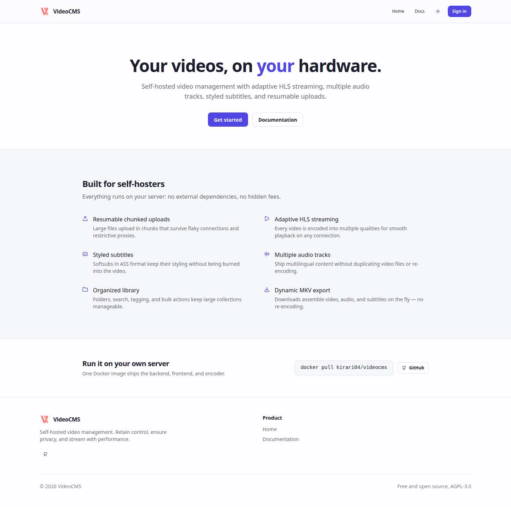
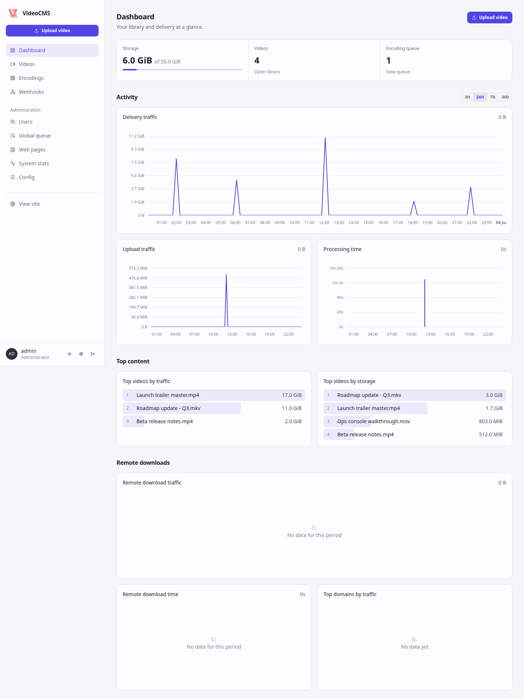
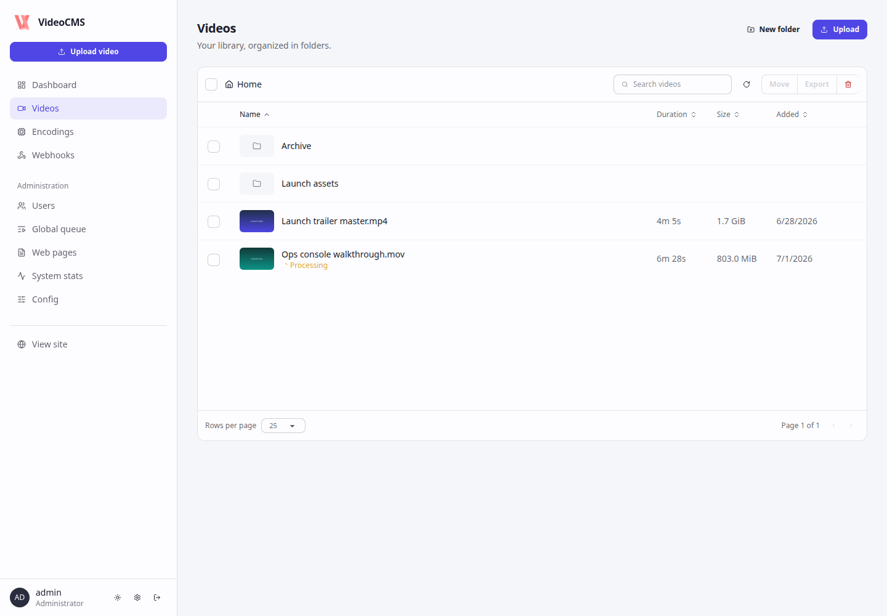
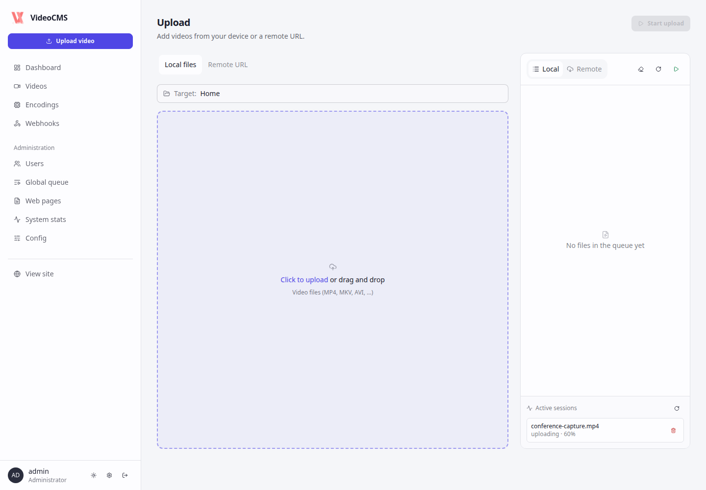
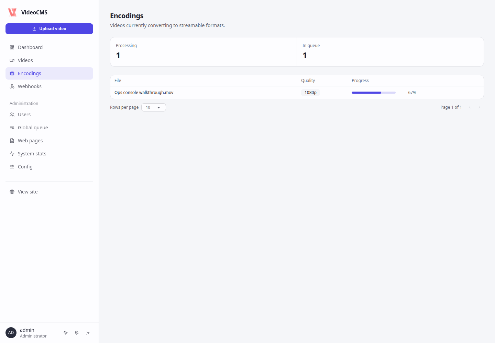
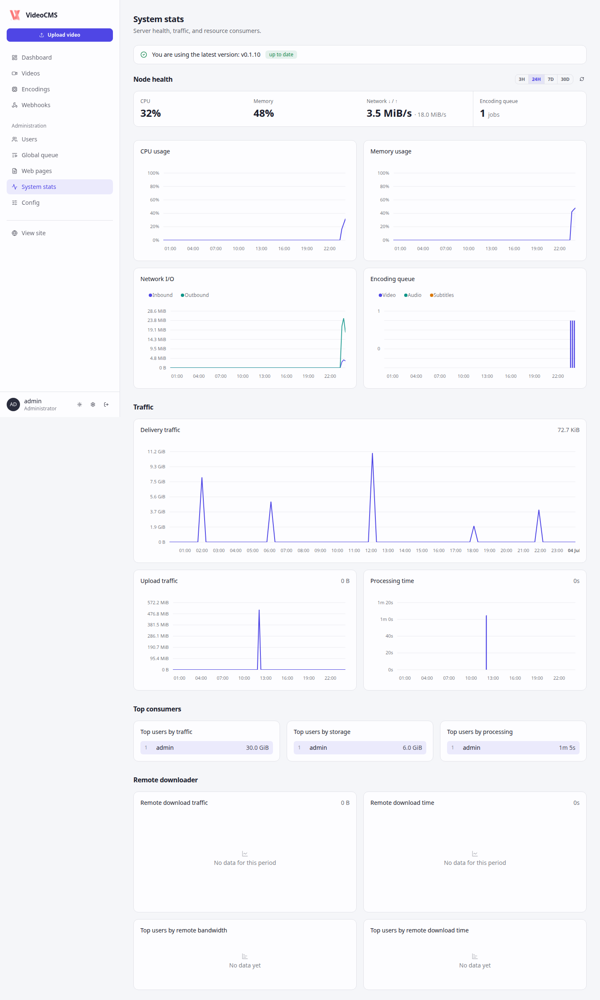
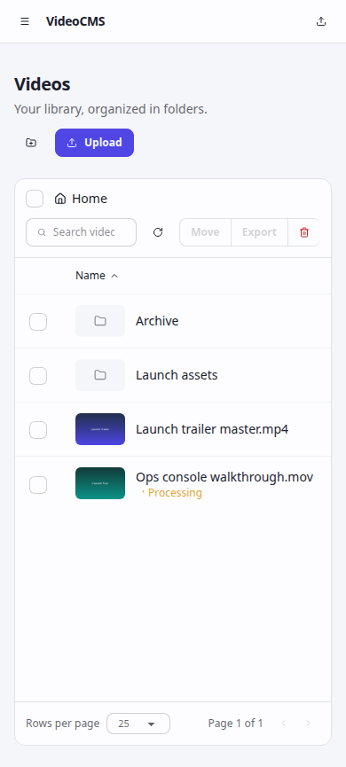

# Video-CMS 🎬

[](https://github.com/Kirari04/videocms/actions/workflows/ci.yml?query=branch%3Adev)
[](https://github.com/Kirari04/videocms/actions/workflows/staging-image.yml?query=branch%3Astaging)
[](https://github.com/Kirari04/videocms/actions/workflows/release.yml?query=branch%3Amaster)
[](https://go.dev/)
[](https://hub.docker.com/r/kirari04/videocms)
[](https://www.gnu.org/licenses/agpl-3.0)

A self-hosted Content Management System for your videos. 🎞️

## Features ✨

- **🔗 Public Video Links:** Videos are public by default through unlisted UUID links; anyone with a link can watch without an account.
- **🏠 Self-host:** Host VideoCMS using Docker on your own hardware.
- **✍️ Pretty Subtitles:** Subtitles are stored as softsubs in the ASS format to preserve styling and save storage.
- **⚡ HLS Multi-Quality:** Videos are converted into multiple qualities to ensure smooth playback for different connection speeds.
- **🔊 Multi-Audio:** The player supports multiple audio tracks that are not stored inside the video, saving storage space.
- **🚀 Fast Chunked Upload:** Allows the server to be behind a proxy without requiring high maximum post limits.
- **📦 Configurable Downloads:** Viewers can choose a ready quality and download MP4 with one audio track, or MKV with selectable audio and subtitle tracks. The server assembles the result without re-encoding.
- **🗄️ Storage Pools:** Keep local storage as the default or route new uploads across S3-compatible buckets and SFTP folders from the admin UI.
- **🔄 Safe Storage Migrations:** Move all videos or one account between pools with resumable copies, verification, atomic cutover, and delayed source cleanup.
- **💾 Read-Through Caches:** Cache frequently played remote media on inexpensive storage and track cache effectiveness in System Stats.
- **🧭 Durable Background Jobs:** Monitor uploads, downloads, encoding, migrations, and maintenance with persistent progress, retries, pause, and cancellation controls.
- **🔗 Folder Sharing:** Share a folder and its subfolders without visitor accounts. Give each link view/download, upload-only, or combined access, with optional passwords, CAPTCHA, and expiration.

## Documentation 📚

Follow the documentation to setup VideoCMS: [https://videocms-docs.vercel.app/](https://videocms-docs.vercel.app/)

Storage mounts, pool routing, upgrade behavior, and reconnecting migrated storage are described in [the storage guide](https://videocms-docs.vercel.app/operations/storage).

Monitoring, canceling, retrying, and troubleshooting background work are described in [the background-jobs guide](https://videocms-docs.vercel.app/operations/background-jobs).

### Folder share links

Choose **Share folder** from a folder's action menu or while browsing inside it. Create multiple independent links, change their permissions, or revoke them from the same dialog. View access includes downloads when server downloads are enabled. Upload-only visitors can send videos without listing or playing existing content; their uploads use the folder owner's storage quota and processing pipeline.

Password and CAPTCHA checks unlock a share for up to six hours. Changes to a share invalidate its visitor sessions and media access at the next request. Shares stop working when they expire or their root folder or owner is deleted. Moving a subfolder outside the shared tree removes it from the share.

Guest uploads recheck access after receiving the whole request, before durable staging. Revoking a share prevents new uploads from being accepted; it does not cancel ingestion of uploads already accepted.

CAPTCHA requires an enabled, configured server provider. Guest uploads currently use the simple upload endpoint, with progress reporting and the server's file size limit. Individual video links remain independently accessible; protecting a folder share does not make existing video links private.

The default deployment serves the share page, API and player from the same origin. A separate frontend on the same site can use `NUXT_PUBLIC_API_URL` and `NUXT_PUBLIC_BASE_URL` with the backend's credentialed CORS settings and an explicit frontend origin; its Content Security Policy must also allow the API origin in `connect-src`. Protected shares use `SameSite=Lax` cookies; frontends hosted on a different site should proxy the backend through their own origin.

Owner APIs are `GET/POST /api/folder-shares` and `PUT/DELETE /api/folder-shares/:id`. Public visitors use `/s/:token`, backed by `GET /api/shares/:token`, `POST /api/shares/:token/unlock`, and `POST /api/shares/:token/uploads`. Owner creation and updates accept `FolderID`, `Name`, `AllowRead`, `AllowUpload`, `RequireCaptcha`, optional `ExpiresAt`, and optional `Password`. Omit `Password` to preserve it; use an empty string to remove it.

## Screenshots 📸

### Landing


### Dashboard


### Library


### Upload Manager


### Encoding Queue


### System Stats


### Mobile Library


## Build 🛠️

```bash
make docker-build
```

## Development

Initialize the frontend and documentation submodules, then start the complete development stack:

```bash
git submodule update --init --recursive
make dev
```

Nuxt is available at `http://127.0.0.1:3000` and proxies `/api` and the backend-owned media routes to the hot-reloading Go server on port `3001`. Stopping either process shuts down the other one cleanly.

## Docker Images

Published images are available from:

- `ghcr.io/kirari04/videocms`
- `kirari04/videocms`

Available tags:

- `latest`
- `beta`
- `staging`
- `vX.Y.Z`
